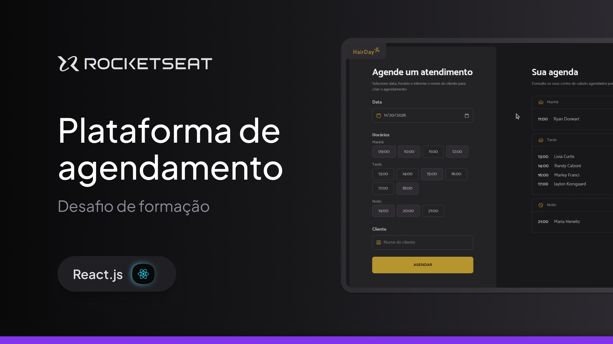
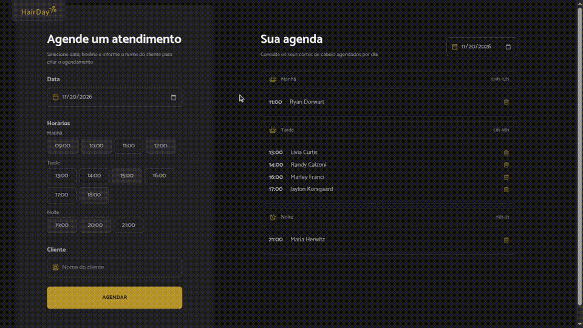

<h1 align="center">HairDay</h1>

<p align="center">
  
</p>

> Aplicação web de agendamento para salão de beleza, permitindo o registro de horários divididos por períodos e o gerenciamento diário de agendamentos.

<p align="center">
  
</p>

## 🚀 Funcionalidades

- 📅 **Novo Agendamento:** Formulário contendo seleção de data, nome do cliente e escolha de horários divididos por períodos (Manhã, Tarde e Noite).
- 🔍 **Filtro Diário:** Seletor de data no painel lateral para filtrar e exibir apenas os agendamentos correspondentes ao dia selecionado.
- 📋 **Listagem por Período:** Agendamentos organizados visualmente em blocos de Manhã, Tarde e Noite para melhor controle da agenda.
- 🗑️ **Gerenciamento de Agenda:** Botão de exclusão para remover agendamentos cancelados ou finalizados.
- 📱 **Layout Responsivo & Moderno:** Interface limpa construída com Tailwind CSS v4 e ícones do Phosphor.

## 🛠️ Tecnologias e Ferramentas

- [React 19](https://react.dev) - Biblioteca para construção de interfaces
- [TypeScript](https://www.typescriptlang.org) - Tipagem estática para JavaScript
- [Tailwind CSS v4](https://tailwindcss.com) - Estilização moderna baseada em utilitários
- [@phosphor-icons/react](https://phosphoricons.com) - Biblioteca de ícones para interface
- [Vite](https://vite.dev) - Empacotador e servidor de desenvolvimento ultrarrápido

## 🚀 Como Executar o Projeto

### Pré-requisitos

Antes de começar, certifique-se de ter instalado em sua máquina:
* [Node.js](https://nodejs.org/)
* [PNPM](https://pnpm.io/) (ou seu gerenciador de pacotes preferido)

### Passo a Passo

1. **Clone o repositório:**
  ```bash
   git clone https://github.com/BrunoBecoski/reactjs-hairday
   cd reactjs-hairday
  ```

2.  **Instale as dependências:**
  ```bash
    pnpm install
  ```

3.  **Inicie o servidor de desenvolvimento:**
  ```bash
    pnpm dev
  ```

Acesse http://localhost:5173 (ou a porta indicada no terminal) no seu navegador para ver a aplicação rodando.
